<div align="center">

# SRO PK2 Studio

**All-in-one editor & viewer for Silkroad Online client archives**
**Silkroad Online istemci arşivleri için hepsi bir arada editör & görüntüleyici**


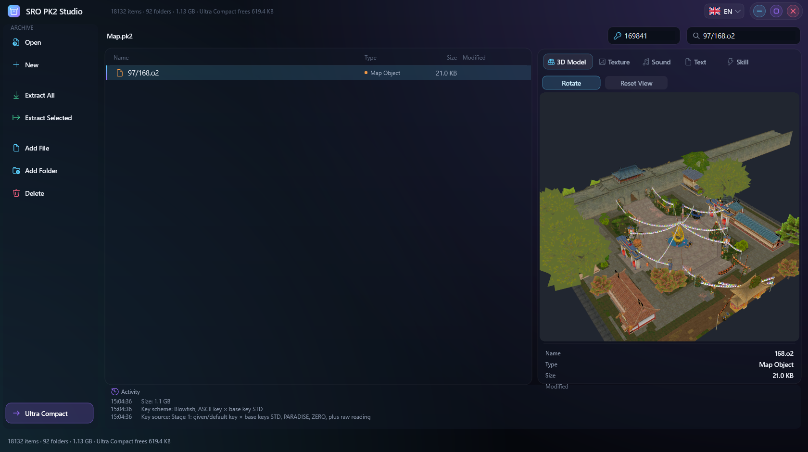

**[English](#english)** · **[Türkçe](#türkçe)**

</div>

---

## English

SRO PK2 Studio opens the **Data / Media / Map / Particles / Music** archives of a Silkroad Online client and shows **every file in a readable form**: models turn in live 3D with their animation, effects play with a bit-exact copy of the game's runtime, skills play on a character with their sounds, `.2dt` interface files are drawn as windows with the client's own textures, and textdata tables open as tables. Nothing falls back to a meaningless hex dump. It is one portable `.exe`: no installer, no DLLs.

### Highlights

- **Archives** — JMXPACK `.pk2` / `.pk3` / `.lib` read + write, SailSafe PK2, **PK2v2** (zstd, read-only), VSROPLUS `.vp`, an unpacked client folder. Sibling archives (Data / Media / Particles / Map) are linked automatically.
- **Ultra Compact (100%)** — rewrites only the open archive with **not a single free byte**: header + the fewest directory blocks + all data back to back. The new archive is written next to the old one, verified, then swapped in; the original is kept as `.bak`. Real result: Media.pk2 **1.37 GB → 1.11 GB** (263.7 MB saved) in **1.2 s**, all 28,987 files byte-identical.
- **Archives that never bloat** — a replaced file is written in place when it fits, otherwise into the best-fitting hole; the space of deleted files and emptied directory blocks is reused and free space at the end is given back to the disk. Extract, bulk add and compaction use every CPU core.
- **Protections** — MaxiGuard, VsroPlus, GoPro, Sailor, HntSRO S-box, vSRO and AES asset ciphers, several Blowfish key schemes, deep key search, a **Protection Report** and cipher key recovery.
- **3D** — `.bsr` / `.cpd` / `.bms` models with skeletal animation and equipment, 16x MSAA, 16x anisotropic filtering. `.nvm`, `.bsk`, `.ban`, dungeons (`.dof`).
- **Real 3D maps** — `.m` terrain painted with the game's own ground textures (`tile2d.ifo`), blended smoothly, with water; `.o` / `.o2` blocks open with their buildings and trees standing on the block's terrain. Drag to turn, right-drag to pan, wheel to zoom, double-click to reset.
- **Skill player** — 32,000+ skills: character + weapon + armour, effects, projectiles, hits and sounds.
- **EFP effect editor** — hue, saturation, brightness, colourise, scale, particle size, speed, duration; live preview, one-click save into the pk2.
- **Textures** — DDJ / DDS (DXT1-5, ATI, P8 …) at original resolution; replace from any image (PNG, TGA, BMP, JPG …), the original DDJ format and mips are kept.
- **Interface (`.2dt`)** — drawn with the client's textures (tab pages included) + a **table editor** (name, position, size, colour, text, image); only the fields you change are written.
- **Textdata** — UTF-16 / UTF-8 / CP949 detected automatically, `*_all.txt` up to 128 MB, table validation, change summary. **skilldata ENC** is decrypted, edited and re-encrypted on save.
- **Client settings** — dedicated editors for `DIVISIONINFO.TXT`, `GATEPORT.TXT` and `SV.T`.
- **Sound** — `.ogg` / `.wav` played inside the program.
- **Its own design** — frameless Direct2D UI: its own title bar, menus, confirmations and **its own file picker** (quick access, recent folders, drives, clickable path bar, filters, multi-select, keyboard navigation). Not a single Windows dialog.
- **5 languages** — English, Türkçe, 中文, 日本語, Tiếng Việt: switch from the flag button in the title bar, changes at once and is remembered.

### Screenshots

| | |
|:---:|:---:|
| 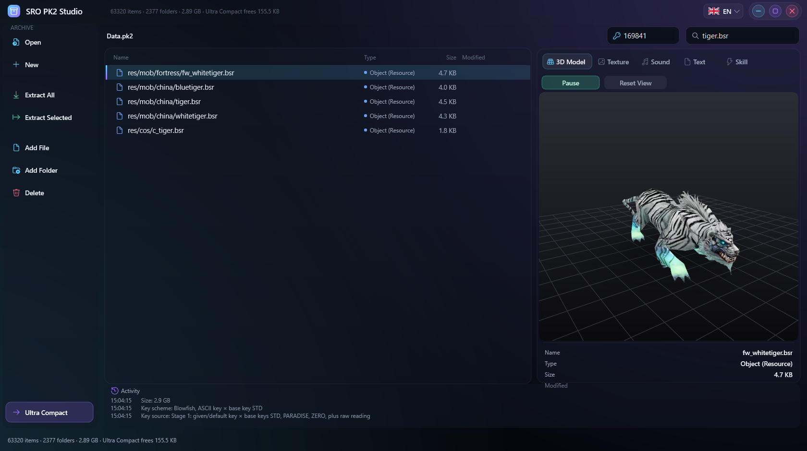 <br> **3D model** — animated, textured | 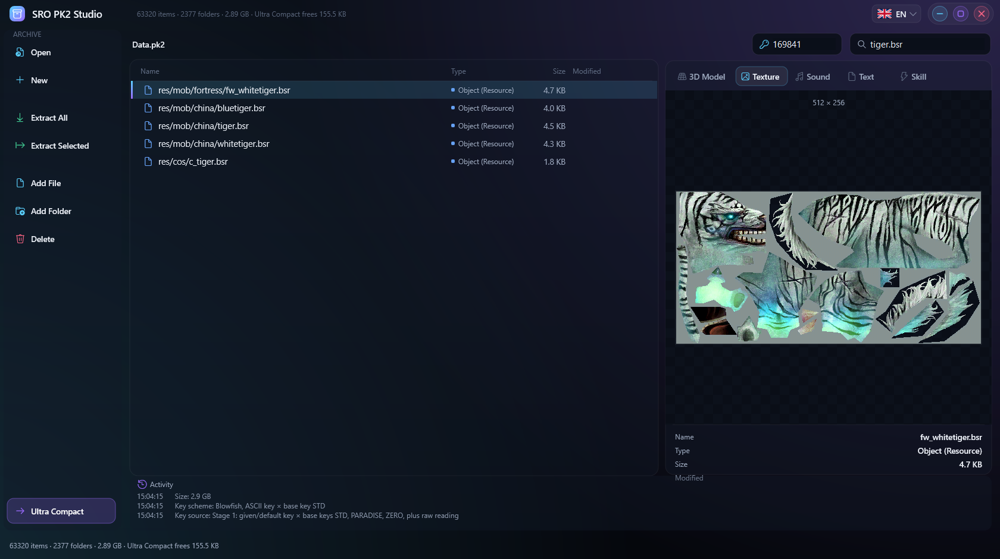 <br> **Texture** — original resolution |
|  <br> **Map block (.o2)** — buildings on their terrain | 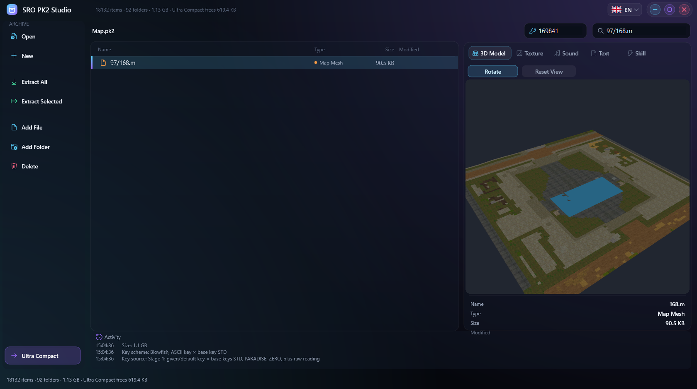 <br> **Terrain (.m)** — ground textures and water |
| 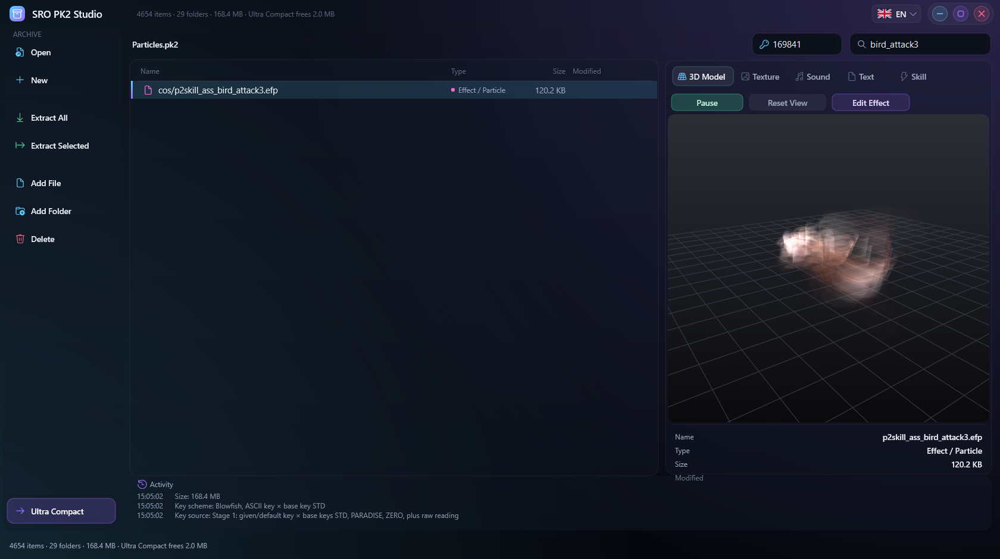 <br> **EFP effect** — live, game runtime | 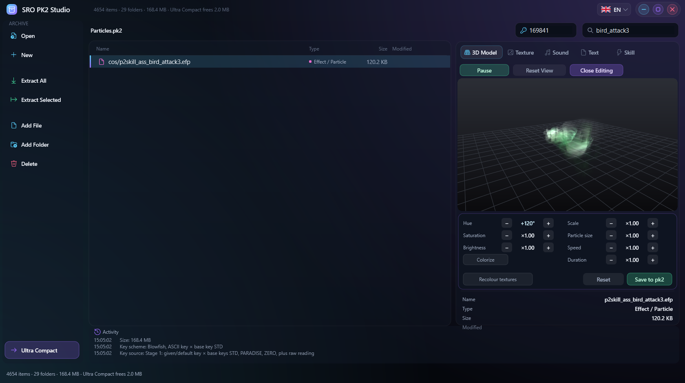 <br> **EFP editor** — hue +120°, live preview |
| 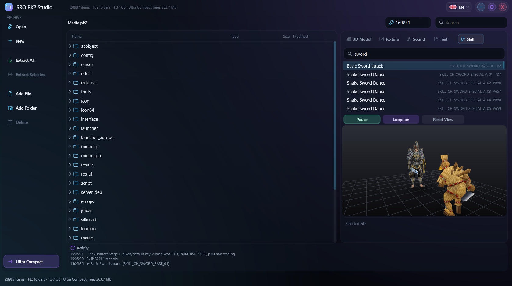 <br> **Skill player** — character, weapon, effects, sound | 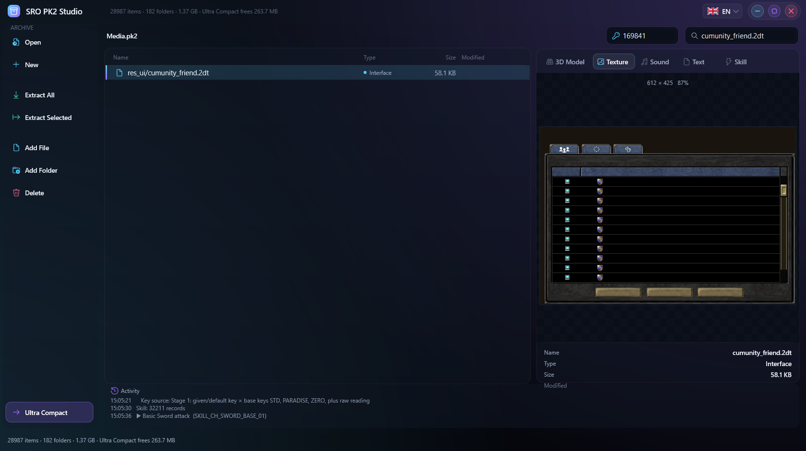 <br> **.2dt window** — client textures |
| 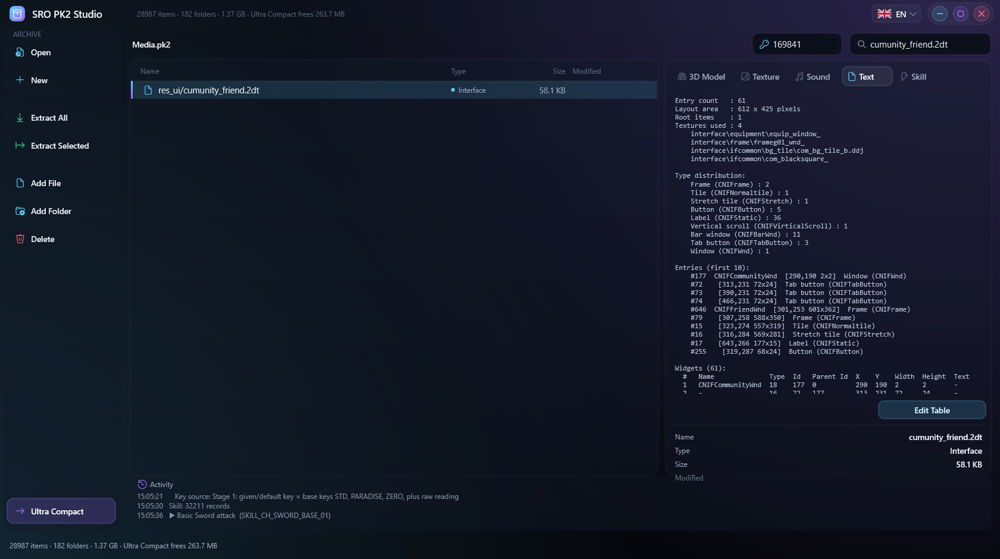 <br> **.2dt element list** | 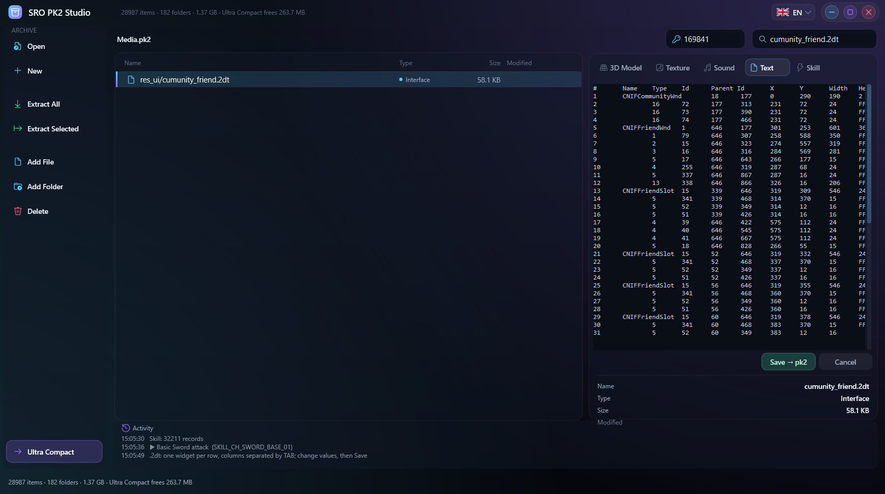 <br> **.2dt table editor** |
| 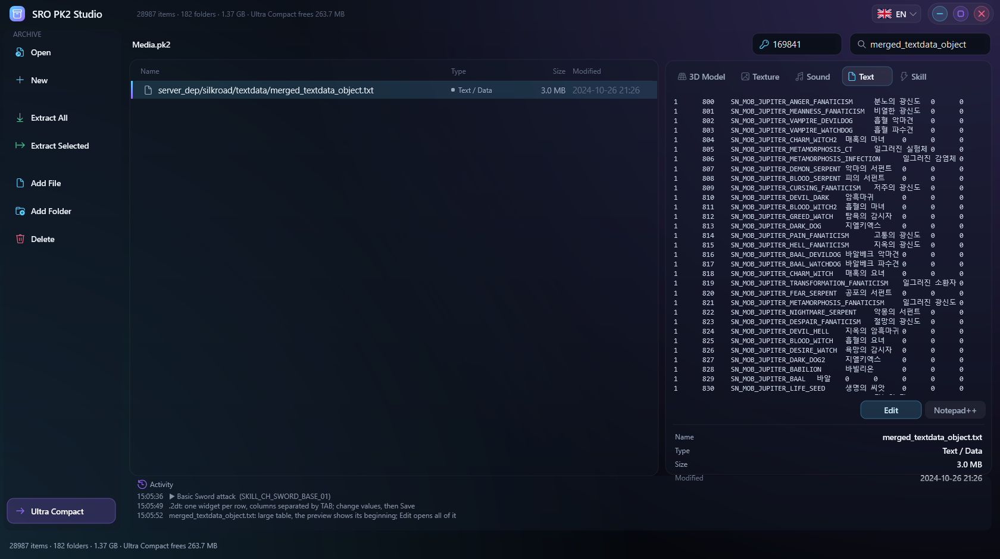 <br> **Textdata** — Korean names in the right encoding | 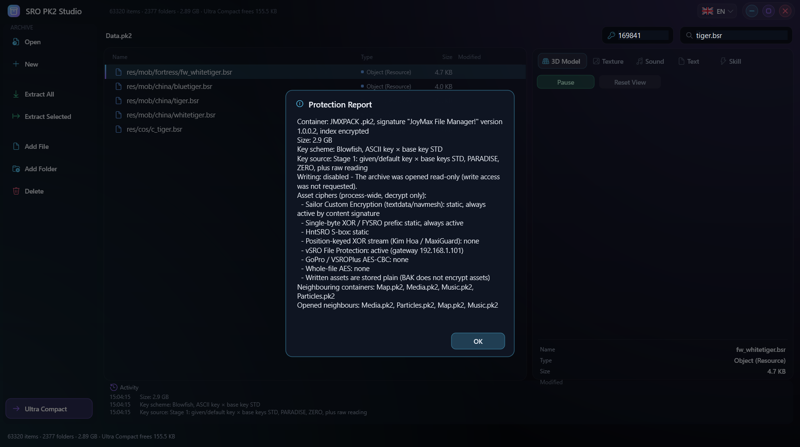 <br> **Protection Report** |
| 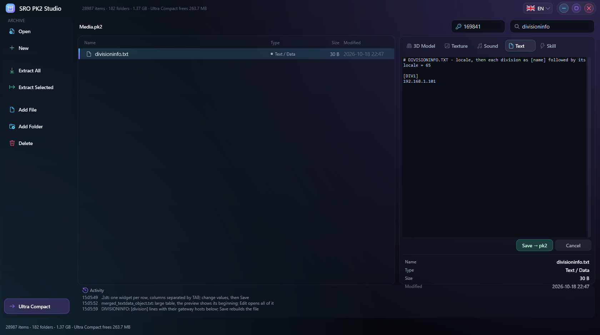 <br> **DIVISIONINFO editor** | 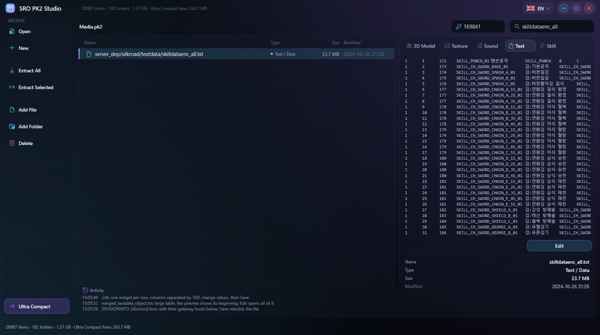 <br> **skilldata ENC** — decrypted, editable |
| 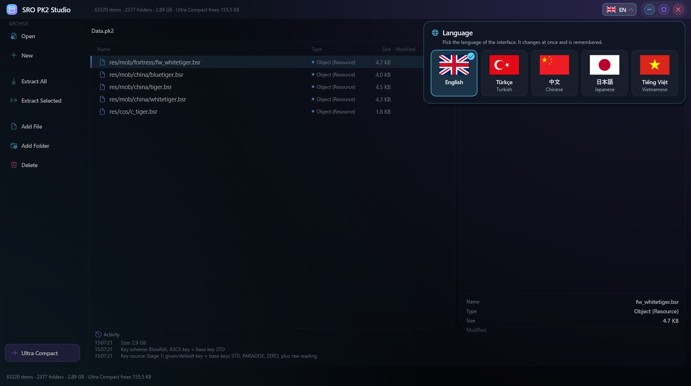 <br> **Language picker** |  <br> **Ultra Compact** — 0 free bytes |
| 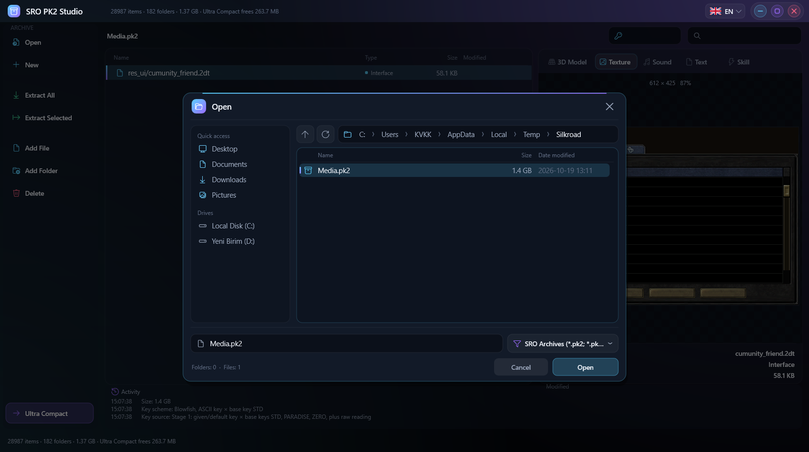 <br> **Its own file picker** | |

### Supported files

| Kind | Extensions | View | Edit |
|---|---|---|---|
| Model | `.bsr .cpd .bms .bmt .bsk .ban` | live 3D + animation | replace file |
| Effect | `.efp` | live effect | EFP editor |
| Texture / image | `.ddj .dds .tga .png .bmp .jpg` | original resolution | replace from image |
| Map | `.m .t .o .o2 .nvm .dof .mfo .ifo` | 3D / texture / table | replace file |
| Interface | `.2dt` | drawn window + element list | table editor |
| Text / table | `.txt .ini .lua .xml .csv .psh .vsh` | text / table | text editor, Notepad++ |
| Encrypted table | `skilldata ENC` | decrypted table | re-encrypted on save |
| Client settings | `DIVISIONINFO.TXT GATEPORT.TXT SV.T` | readable values | structured editor |
| Sound | `.ogg .wav` | plays in the app | replace file |
| Other | font `.dat`, palette, `plugin.dat`, camera … | readable analysis | hex editor |

### Usage

1. Run `SroPk2Studio.exe` (nothing to install).
2. **Open** a `.pk2` / `.vp` in the app's file picker, or drop it onto the window. The default key is `169841`.
3. Pick a file in the list: the preview tabs (**3D Model · Texture · Sound · Text · Skill**) open by themselves.
4. Edit → Save writes straight into the pk2 (a `.bak` backup is taken on the first change). When you are done, **Ultra Compact** shrinks the archive to 100%.

Command line: `SroPk2Studio.exe [--lang en|tr|zh|ja|vi] [archive]`. Without `--lang` the saved choice is used, else the Windows UI language.

### Build

Requires **Visual Studio 2022 or 2026** with the **"Desktop development with C++"** workload, Windows 10/11 x64.

```bat
build.bat
```

Output: `bin\SroPk2Studio.exe` — the only file in `bin\` (static runtime, no DLLs); intermediate files stay in `obj\`.
In Visual Studio: open `SroPk2Studio.sln` → **Release | x64** → Build.

CMake 4.0+ with Ninja (from a Visual Studio x64 developer prompt):

```bat
cmake --preset release
cmake --build --preset release
```

The `debug` preset builds into `bin\Debug\`. `tools\gen_vsproj.ps1` regenerates the `.sln` / `.vcxproj` from the CMake build when the source list changes.

### Tests

The `tests` preset also builds console test programs that run against a real client (they never write to its archives):

```bat
set SRO_CLIENT_DIR=D:\Games\Silkroad
cmake --preset tests
cmake --build --preset tests
obj\cmake\tests\tests\pk2test.exe
```

`pk2test` (archive engine, compaction, write paths), `i18n_test` (every key filled in all 5 languages, matching placeholders), `bakbridge_test`, `bak2view_test`, `bak2tools_test`, `bak2more_test`, `coverage_test` (every extension of Data / Media / Map / Particles / Music previews without an empty or broken view).

### Project layout

```
src\          application (Win32 + Direct2D / Direct3D 11 / OpenGL)
src\i18n\     translation tables for the 5 languages (en, tr, zh, ja, vi)
src\bak\      SRO Asset Studio: archives, ciphers, format decoders
src\bak2\     SkillEffect Studio: effect + model rendering, skill playback, EFP writer, DDJ encoder
src\thirdparty\  stb_vorbis
tests\        console tests against real client archives
cmake\        CMake modules
tools\        gen_vsproj.ps1 (.sln generator)
docs\         screenshots
build.bat     one-click Release build
```

### Safety

- An automatic `.bak` backup is made on the first change to an archive.
- Editors write only the fields you changed; every other byte stays as it was.
- Invalid values (letters where a number belongs, a port above 65535 …) are not saved; the reason is shown with row and column.
- Compaction writes a new archive next to the old one and replaces it only after verification.

### Credits

- **SRO Asset Studio** (`src/bak`) — archives, ciphers and format decoders.
- **SkillEffect Studio** (`src/bak2`) — effect and model rendering, skill playback, EFP writer, DDJ encoder, table tools.
- [stb_vorbis](https://github.com/nothings/stb) — public domain / MIT (`src/thirdparty/stb_vorbis.c`).
- [Zstandard](https://github.com/facebook/zstd) — BSD / GPLv2 (`src/bak/core/zstd.*`).

---

## Türkçe

SRO PK2 Studio, Silkroad Online istemcisinin **Data / Media / Map / Particles / Music** arşivlerini açar ve içindeki **her dosyayı okunur hâlde** gösterir: modeller animasyonuyla canlı 3D döner, efektler oyundaki çalışma zamanının birebir kopyasıyla oynar, skill'ler karakterin üzerinde sesleriyle oynatılır, `.2dt` arayüz dosyaları istemcinin kendi dokularıyla pencere olarak çizilir, textdata tabloları tablo olarak açılır. Hiçbir dosya anlamsız bir hex dökümüne düşmez. Tek parça (portable) bir `.exe`: kurulum yok, DLL yok.

### Öne çıkanlar

- **Arşivler** — JMXPACK `.pk2` / `.pk3` / `.lib` okuma + yazma, SailSafe PK2, **PK2v2** (zstd, salt okunur), VSROPLUS `.vp`, açılmış istemci klasörü. Yanındaki arşivler (Data / Media / Particles / Map) otomatik bağlanır.
- **Ultra Sıkıştır (%100)** — yalnız açık olan arşivi **tek bir boş bayt bırakmadan** yeniden yazar: başlık + en az sayıda dizin bloğu + verinin tamamı art arda. Yeni arşiv yanına yazılır, doğrulanır, sonra yerine konur; eski hâli `.bak` olarak saklanır. Gerçek sonuç: Media.pk2 **1,37 GB → 1,11 GB** (263,7 MB kazanç) **1,2 saniyede**, 28.987 dosyanın hepsi birebir aynı.
- **Şişmeyen arşiv** — değiştirilen dosya sığıyorsa yerinde, sığmıyorsa en uygun boşluğa yazılır; silinen dosyaların ve boşalan dizin bloklarının yeri tekrar kullanılır, dosya sonundaki boşluk diske geri verilir. Çıkartma, toplu ekleme ve sıkıştırma tüm çekirdekleri kullanır.
- **Korumalar** — MaxiGuard, VsroPlus, GoPro, Sailor, HntSRO S-box, vSRO ve AES varlık şifreleri, farklı Blowfish anahtar şemaları, derin anahtar arama, **Koruma Raporu** ve şifre anahtarı kurtarma.
- **3D** — `.bsr` / `.cpd` / `.bms` modeller iskelet animasyonu ve ekipmanla, 16x MSAA, 16x anizotropik filtre. `.nvm`, `.bsk`, `.ban`, zindanlar (`.dof`).
- **Gerçek 3D harita** — `.m` arazisi oyunun zemin dokularıyla (`tile2d.ifo`) yumuşak geçişli boyanır, su yüzeyleriyle; `.o` / `.o2` blokları bloğun arazisinin üstünde binaları ve ağaçlarıyla açılır. Sürükle: döndür, sağ sürükle: kaydır, tekerlek: yakınlaştır, çift tık: sıfırla.
- **Skill oynatıcı** — 32.000+ skill: karakter + silah + kıyafet, efektler, mermiler, vuruşlar ve sesler.
- **EFP efekt düzenleyici** — renk tonu, doygunluk, parlaklık, renklendir, ölçek, parçacık boyutu, hız, süre; canlı önizleme, tek tıkla pk2'ye kayıt.
- **Doku** — DDJ / DDS (DXT1-5, ATI, P8 …) orijinal çözünürlükte; herhangi bir resimden (PNG, TGA, BMP, JPG …) değiştirme, orijinal DDJ biçimi ve mip'ler korunur.
- **Arayüz (`.2dt`)** — istemcinin dokularıyla çizilir (sekme sayfalarıyla) + **tablo düzenleyici** (ad, konum, boyut, renk, metin, görsel); yalnız değiştirdiğin alanlar yazılır.
- **Textdata** — UTF-16 / UTF-8 / CP949 otomatik, 128 MB'a kadar `*_all.txt`, tablo doğrulama, değişiklik özeti. **skilldata ENC** çözülür, düzenlenir, kaydederken yeniden şifrelenir.
- **İstemci ayarları** — `DIVISIONINFO.TXT`, `GATEPORT.TXT` ve `SV.T` için ayrı düzenleyiciler.
- **Ses** — `.ogg` / `.wav` program içinde çalınır.
- **Kendi tasarımı** — çerçevesiz Direct2D arayüz: kendi başlık çubuğu, menüleri, onay kutuları ve **kendi dosya penceresi** (hızlı erişim, son klasörler, sürücüler, tıklanabilir yol çubuğu, filtre, çoklu seçim, klavyeyle gezinme). Hiçbir Windows penceresi yok.
- **5 dil** — English, Türkçe, 中文, 日本語, Tiếng Việt: başlık çubuğundaki bayraktan seçilir, anında değişir ve hatırlanır.

Ekran görüntüleri için yukarıdaki [Screenshots](#screenshots) bölümüne bakın.

### Kullanım

1. `SroPk2Studio.exe`'yi çalıştır (kurulum gerekmez).
2. **Aç** ile programın kendi dosya penceresinden `.pk2` / `.vp` seç ya da pencereye sürükle-bırak. Varsayılan anahtar `169841`.
3. Listeden dosya seç: önizleme sekmeleri (**3B Model · Doku · Ses · Metin · Skill**) kendiliğinden açılır.
4. Düzenle → Kaydet: değişiklik doğrudan pk2'ye yazılır (ilk değişiklikte `.bak` yedeği alınır). İşin bitince **Ultra Sıkıştır** ile arşivi %100 küçült.

Komut satırı: `SroPk2Studio.exe [--lang en|tr|zh|ja|vi] [arşiv]`. `--lang` verilmezse kaydedilen seçim, o da yoksa Windows dili kullanılır.

### Derleme

Gerekli: **Visual Studio 2022 veya 2026**, **"Desktop development with C++"** iş yükü, Windows 10/11 x64.

```bat
build.bat
```

Çıktı: `bin\SroPk2Studio.exe` — `bin\` içinde yalnız bu dosya bulunur (statik çalışma zamanı, DLL yok); ara dosyalar `obj\` altında kalır.
Visual Studio ile: `SroPk2Studio.sln` → **Release | x64** → Build.

CMake 4.0+ ve Ninja ile (Visual Studio x64 geliştirici komut isteminde):

```bat
cmake --preset release
cmake --build --preset release
```

`debug` ön ayarı `bin\Debug\`'a derler. Kaynak listesi değişince `tools\gen_vsproj.ps1` `.sln` / `.vcxproj` dosyalarını CMake derlemesinden yeniden üretir.

### Testler

`tests` ön ayarı gerçek bir istemciyle çalışan konsol testlerini de derler (arşivlere asla yazmazlar):

```bat
set SRO_CLIENT_DIR=D:\Games\Silkroad
cmake --preset tests
cmake --build --preset tests
obj\cmake\tests\tests\pk2test.exe
```

### Güvenlik

- Arşivdeki ilk değişiklikte otomatik `.bak` yedeği alınır.
- Düzenleyiciler yalnız değiştirdiğin alanları yazar; dokunmadığın her bayt aynen kalır.
- Hatalı değer (sayı yerine harf, 65535'ten büyük port …) kaydedilmez; nedeni satır ve sütunla gösterilir.
- Sıkıştırma yeni arşivi yanına yazar, doğruladıktan sonra yerine koyar.

### Teşekkürler

- **SRO Asset Studio** (`src/bak`) — arşivler, şifreler ve biçim çözücüleri.
- **SkillEffect Studio** (`src/bak2`) — efekt ve model render, skill oynatma, EFP yazıcı, DDJ kodlayıcı, tablo araçları.
- [stb_vorbis](https://github.com/nothings/stb) — public domain / MIT; [Zstandard](https://github.com/facebook/zstd) — BSD / GPLv2.
